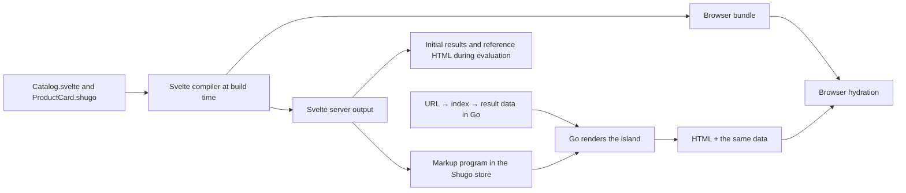

# Svelte island with server-side HTML rendering in Go

A direct link with filters returns HTML showing the matching products. `shugo serve` reads the index and executes the island's markup program, which Shugo generates at build time. Svelte hydrates the resulting DOM in the browser and updates the results when filters change. The GET form works with JavaScript disabled.

This experiment builds on the [first version with a JavaScript worker](REPORT.md). The new server handles the requests in Go. [Run the example](README.md)

## The boundary between Go and Svelte

1. **Compilation.** For the island of `export const shugoSSR = true` Svelte 5.59.1 makes a normal browser and server build. Shugo reads the server output tree at the build stage. It removes HTML literals, hydration tags, text and attributes, branches, repeats and direct calls to the input components. The boxes and branches have links to JSON fields and constants. The programs are recorded in `site.json` and then in the page vault. [Compilation of Svelte](https://svelte.dev/docs/svelte/svelte-compiler) · [Version 5.59.1 labels](https://github.com/sveltejs/svelte/blob/svelte%405.59.1/packages/svelte/src/internal/server/hydration.js)
2. **Page evaluation.** The standard `eval.mjs` on Bun or Node computes the props and compares the Go program's output with Svelte's native SSR. A mismatch in the initial results prevents publication. The build stores parameter-free HTML as before. Islands with props fully determined at build time, such as counters, use Svelte's standard SSR at this stage.
3. **Filtered request.** Go reads the page and index version from the same store snapshot and runs the search. The markup program selects branches and loops and escapes inserted values for their context. The response contains the HTML with hydration markers and the same props that the program used.
4. **Browser.** Svelte's `hydrate` attaches to the existing DOM. When users change filters, the island updates the URL and fetches the next results from the JSON API. The browser handles events, history, and requests. [Svelte hydration](https://svelte.dev/docs/svelte/imperative-component-api#hydrate)

The render program for the catalog and card contains 123 operations in a compact representation of about 8 KB. One program covers any number of pages and filter combinations. Both island bundles use `ProductCard.shugo`, and ordinary Shugo pages can use it too. The live route shares this card template.

## Approaches considered

| Method | What the test showed |
| --- | --- |
| Compiling Svelte server output into the markup program | This option is implemented. Svelte compiler already solves the details of the gaps, branches and markers for the browser. Shugo converts its output into a limited set of data transactions. It works with the storage facility and published pages. |
| Cut the real SSR on finished fragments | The test catalog with fragments for the marked facets, cards and pagination was similar to SSR Svelte in all 88 checks. The cluster of fragments took about 7 kB. They had to be collected by manually described catalog structure. The new branch in the markings requires a change of extraction rules. |
| Prepare HTML each card in advance | In the sample, 100,000 cards were taken by 39.4 MB HTML The generator took about 1.1 with the process warmed up. SvelteThe way you optimize expensive cards is to optimize the cost of your cards, and the facets, empty issuances and pagination still require their program. It's impossible to overwrite the pages that are finished, with only 50 independent marks being given to the full. \(2^{50}\) The combination before the text and price. |
| Compiling reference markings at Go | This is the approach SvelteGo, and templ has a similar idea with its own syntax. In Shugo, he would require that the Svelte rules be accompanied by itself for markers, spaces and attributes. The chosen method uses these details from the official SSR compilation. [SvelteGo](https://github.com/binsarjr/sveltego) · [templ](https://templ.guide/) |
| Start SSR inside one Go-binarnic | Golte uses Goja, projects with QuickJS/Wasm also retain the JS engine during HTTP request. This option is not available for a given boundary. API - Yes. Svelte It also involves the launch of a compiled component. [Golte and Goja](https://github.com/nichady/golte/blob/master/go.mod) · [Example SSR via QuickJS/Wasm](https://github.com/bennypowers/lit-ssr-wasm) · [Svelte custom renderers](https://svelte.dev/docs/svelte/custom-renderers) |
| Save only the initial results and apply URL after hydration | This option is suitable for the publication of files on CDN. The direct link first shows the initial results, and the GET form on the file hosting cannot filter the answer. From existing projects, Planti uses Go and Svelte to pre-build static pages. [Plenti](https://github.com/plentico/plenti) |

The selected program takes almost as much as the sample fragments and is generated from existing markings automatically. The difference is particularly important when changing the template: the author changes the Svelte component, and the build checks that Go can show it with the same tags.

## Verification

- **Server isolation.** The verification script deploys the Go binary, published store, index, and browser assets. It uses an empty `PATH` and points the configuration at a missing JavaScript runtime. The deployed files omit the source database, templates, `eval.mjs`, and `node_modules`. Shugo serves every request without child processes.
- **Byte coincidence.** 11 HTTP responses are checked from `render` of `svelte/server` on the same props, including empty release, long page, combined facets, price 0, availability, sorting and line with HTML symbols. Props in HTML are the same as JSON API. The verification is performed after build and with Bun and Node. The `.toFixed()` call immediately stops the build at the request mark.
- **Hydration.** Nine Chromium catalog scenarios passed against the isolated Go server with Svelte's automatic recovery disabled. With the bundle deliberately delayed, hydration preserved the title and first card DOM nodes that the browser had created from server HTML. Loading made no duplicate request for the results. A separate test island also retained the DOM node in an inner loop.
- **Interactivity.** Changing categories, sizes, price range, sort order, pages, or browser history preserves the current document. A late response cannot replace a newer one, and users can retry a failed request. With JavaScript disabled, the form submits a GET and the first response shows the filtered list and the control state.

## Limitations

The Go program reads JSON fields, booleans, and arrays. The Go projection prepares values such as formatted prices, selected facets, page bounds, and pagination URLs. Arbitrary calculations in server markup cause a build error. Browser handlers still use Svelte's features. For example, server HTML sets `selected` on sort options, and a browser effect restores the field on history navigation.

The compilation depends on the fixed server output of Svelte 5.59.1. When updating Svelte, it is useful to run byte comparison and browser test before changing version. The format of the old worker experiment requires a re-build of `shugo build`.

The bar uses the store and URL `/catalog`. The next synthesis is a named source of data linked to a particular island on the page. The search still reads the entire selected order for the phaset count, and the change log can re-engineer the index in its entirety. The search index and SSR have a separate value. The measurements below show where optimization will have an effect.

## Comparison with the worker version

Two versions are collected from separate copies of the originals with the same determinized base. Each size consists of five fresh assemblies and five series of 60 warm consecutive requests for the route. Requests were made for loopback. Go 1.27.4, Bun 1.4.4 in the build phase, Intel Xeon E3-1270 v6, eight logical CPUs. Time in milliseconds. Each pair first has a worker version, then Go. [Measurement scenario](scripts/bench.mjs)

| Products | Build whole | First filter transition | First transition after the JSON index is warmed up | HTML p50 | HTML p95 |
| ---: | ---: | ---: | ---: | ---: | ---: |
| 1,000 | 399 → 444 | 30.6 → 6.6 | 25.7 → 2.0 | 1.39 → 1.32 | 1.71 → 1.71 |
| 10,000 | 516 → 565 | 85.0 → 54.9 | 27.5 → 3.4 | 3.55 → 3.31 | 4.26 → 4.35 |
| 100,000 | 1,735 → 1,807 | 678.0 → 654.3 | 50.0 → 25.6 | 25.92 → 25.62 | 28.50 → 27.63 |

Some 32–52 ms of additional build was produced. In an already operational server, about 24 ms was lost, which the first HTML request spent on launching a worker. For 100,000 products, the first reading of the 38.5 MB index still takes about 656 ms, as seen in the first JSON request. After warming up JSON in the same scenario, it is 24.62 ms mid-point. For this data, the transition to Go reduces the pivot dependency and cold start of the render. Searching takes most of the time of the HTML response.

The first page per 1,000 items grew from 30,058 to 38,275 byte HTML, after gzip from 4,163 to 4,767 bytes. Go began to give props ready signatures, links and flags. JS has decreased from 30,842 to 29,754 byte gzip. Together with the total CSS, the first load in total decreased from 36,639 to 36,155 bytes gzip. JSON has the same filtered request, and after gzip, the weight has increased from 1,010 to 1,390 bytes per 1,000 products and from 1,538 to 2,258 bytes per 100,000.

For 100,000 products with eight customers, the filtered HTML changed from 35.65 to 31.30 ms p50, from 61.23 to 40.90 ms p95 and from 194 to 239 responses/s. JSON API, without a render p95, changed from 37.38 to 45.83 ms in the same series. Due to the dispersion and the new format of JSON, capacity increases should be considered as an observation for this load. The steady win is the absence of a JS-tracker launch in the first round.

In Chromium, the first drawing for 1,000 commodities was 68 ms for the static page and 56 ms for the island locally, 452 ms and 472 ms for deceleration. The island is ready to interact through 64 ms and 1.13 cc, respectively. The filter change in the slow profile took 386 ms, and the GET form took 486 ms. The first version of the separate browser race was 297 ms and 446 ms. The network was transmitting uncompressed answers. The growth of the body size of JSON is measured, and the old and new browser runs are also different from the updated counter-ol model. Seven script launches, 150 ms delay, 1.6 Mbit/s down and 0.75 Mbit/s up, CPU slows four times. [Chromium script](scripts/browser-timing.mjs)
